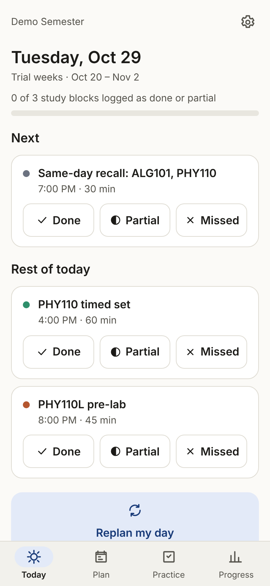
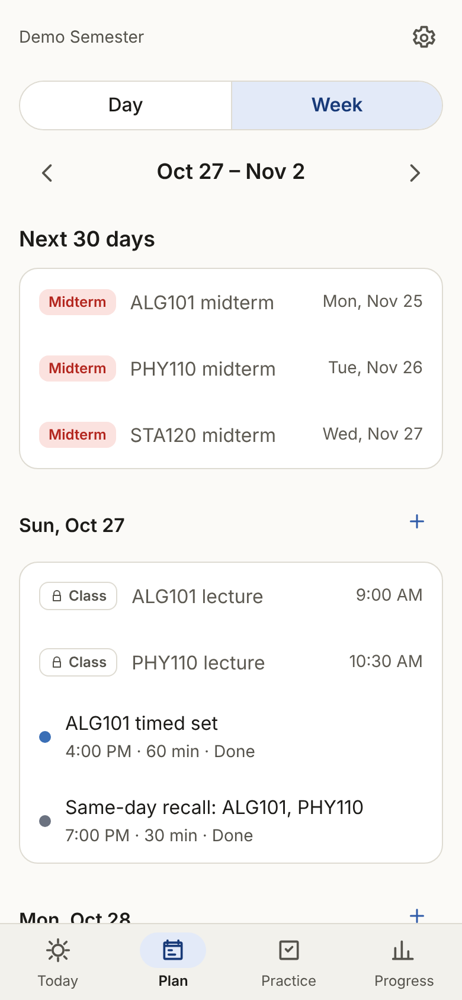

# Adaptive Study Planner (Android)

An offline Android app for planning a semester's study blocks, logging what actually happened, and replanning when a day goes wrong.

## Download

**[Latest release](https://github.com/Asif-Bin-Mahmood/adaptive-study-planner-android/releases/latest)** · direct APK: [study-planner.apk](https://github.com/Asif-Bin-Mahmood/adaptive-study-planner-android/releases/latest/download/study-planner.apk)

To install on Android 7.0 or newer, open the downloaded APK and allow your browser or file manager to install unknown apps when asked. Each release lists the APK's SHA-256 checksum. Updates install over the existing app only when they are signed with the same release key, so always update from this repository's Releases page.

## Features

- Setup wizard for any semester: courses, labs, class times, exams, projects
- Today view with one-tap Done / Partial / Missed and a sleep and focus check-in
- Deterministic replanning (missed blocks, lost time, new deadlines, cancelled classes, exam changes) with a cap on carried-over work and a confirmation step
- Timed practice sets, an error log, and spaced retests
- Weekly completion, accuracy and review
- Optional study reminders (inexact alarms)
- Versioned JSON backup and restore with validation, preview and undo

## Stack

React 19, TypeScript, Vite, Capacitor 8, SQLite (`@capacitor-community/sqlite`; sql.js in tests and the browser preview), Vitest.

## Screenshots

Browser preview with synthetic demo data:

 

## Build

Requires Node 22+ and JDK 21 with the Android SDK (API 36).

```sh
npm ci
npm test
npm run build
npx cap sync android
cd android && ./gradlew assembleDebug
```

See [docs/BUILD.md](docs/BUILD.md) for Android Studio and device steps, [docs/RELEASE_SIGNING.md](docs/RELEASE_SIGNING.md) for signed releases, and [docs/DATABASE.md](docs/DATABASE.md) for the schema.

## Privacy

Data is stored in an on-device SQLite database. There is no account, backend, analytics or telemetry. The web layer's Content Security Policy only allows the app's own origin, and Android auto-backup is disabled. Data leaves the device only when you export a backup file. The database is not encrypted.

## Security

See [SECURITY.md](SECURITY.md).

## License

No license has been chosen yet, so default copyright applies and no reuse rights are granted.
